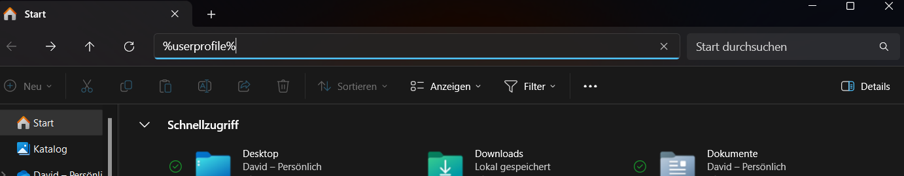
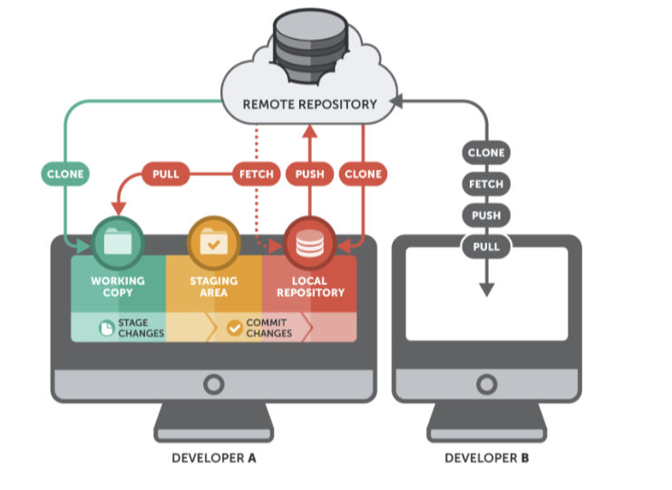
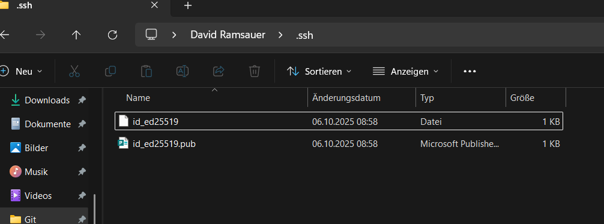
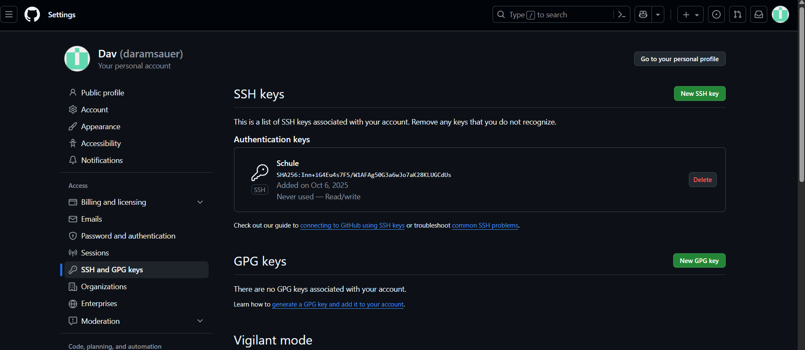
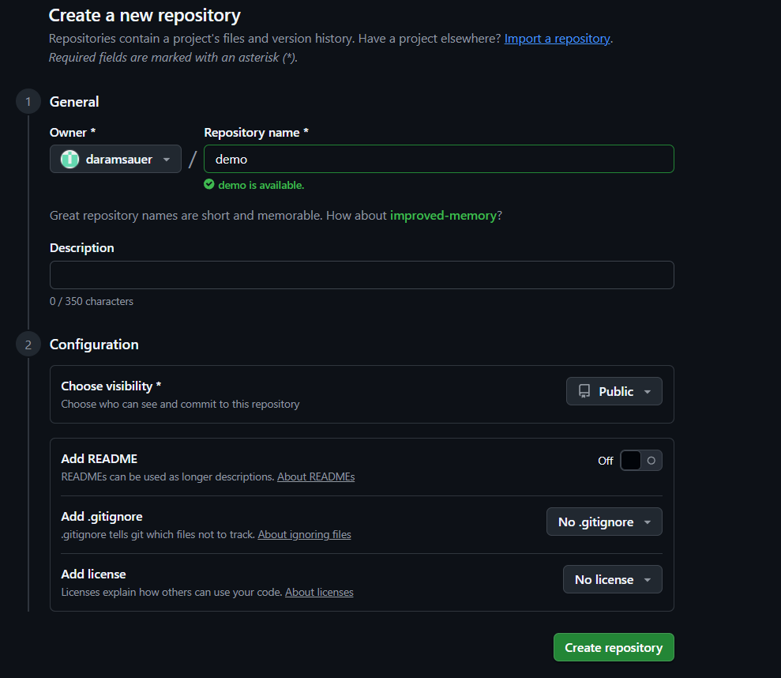
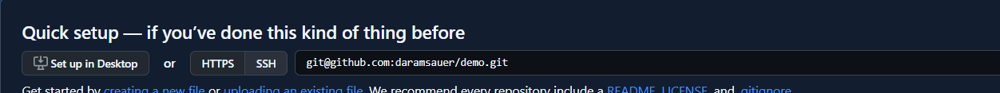
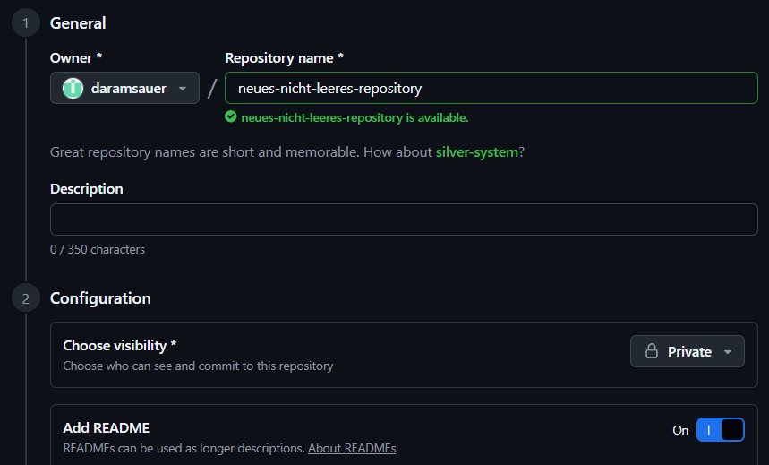
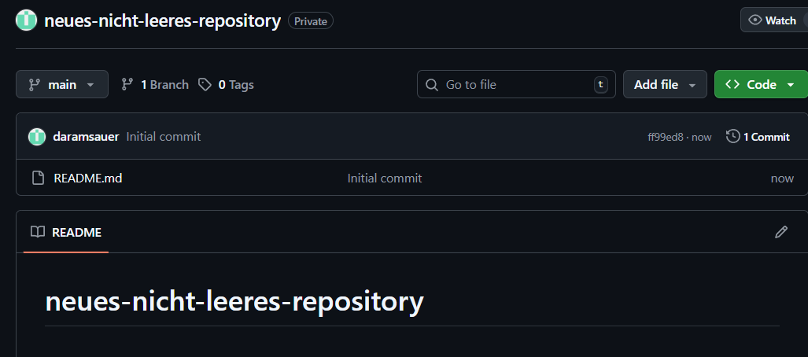

# Arbeit mit Git
## Konfiguration
 
Die Konfiguration wird bei der ersten verwendung durchgeführt. Anschließend gelten die Werte für alle neuen Projekte.
 
In der Eingabeaufforderung werden folgende Befehle ausgeführt:
 
```
git config --global user.git config --global user.name "david ramsauer"
email "dramsauer@schueler.hakzell.at"
git config --global init.defaultBranch "main"
```
 
Da Der Parameter `--global` verwendet wird können diese Befehle in einem beliebigen Verzeichnis ausgeführt werden.
 
**Hinweis:** Falls Git neu installiert wurde, müssen sämtliche Eingabeaufforderungen (Fenster) vor der Befehlsausführung geschlossen werden.
 
Nach der Ausführung dieser Befehle befindet sich im Benutzerprofil (`%userprofile%`)
eine Datei namens `.gitconfig` mit folgendem Inhalt:
```
[user]
    name = david ramsauer
    email = dramsauer@schueler.hakzell.at
[init]
    defaultBranch = main
```
 

 
 

 
 
## Allgemeines
 
Ein Git-Repository unterscheidet grundsätzlich zwischen drei
Bereichen:
 
-`working copy`
-`staging area`
-`local repository`
 

 
im **working copy** befinden sich alle Dateien eines Verzeichnisses
(z.B. README.md, Bilder, Word-Dateien, etc.) Möchte man den Inhalt eines Ordners versionieren ("unter Git stellen"), so müssen die Dateien zur **staging area** hinzugefügt werden. Nach einem Commit werden die verwalteten Dateien in einem **repository** gespeichert.

## Laufende Arbeit mit Git

### Repository erstellen

Ein Repository wird **ein einziges Mal** erstellt. Hierzu wechselt man in den Ordner und führt dort in der Kommandozeile bzw. Powershell

```
git init
```

aus.

**Hinweis:** Durch `git init`wird im Ordner ein *.git*-Verzeichnis erstellt.
Eventuell ist das Verzeichnis nicht sichtbar (ausgeblendete Elemente in Windows zuvor einblenden.)

### Elemente hinzufügen

Datein und (nicht leere) Ordner werden folgendermaßen hinzugefügt:

```
git add .
git commit -m "add file"
```

Mit `git add .` werden alle Veränderungen (zB neue Datei, veränderte Datei, gelöschte Datei, etc.) in den Staging-Bereich gegeben. Mit `git commit` wird der Staging-Bereich ins Repository geschrieben (gesichert). Um Commits mit logischen (zusammengehörenden) Einheiten zu erstellen, können gezielt Datein mittels `git add filename` zum Staging-Bereich hinzugefügt werden. Dadurch können "bessere" Commits erstellt werden. In den Anführungszeichen wird eine kurze Nachricht, die den Inhalt des Commits beschreibt festgelegt.

### Remote-Repository hinzufügen

Ein lokales Repository kann auf zB GitHub remote gespeichert werden. Hierzu ist eine Anmeldung (Authentifizierung) bei GitHub notwendig.

Die Anmeldung erfolgt mittels *SSH-Schlüssel*, welche folgendermaßen in der Eingabeaufforderung generiert werden:

```
ssh-keygen - t ed 25519
```

Hierdurch wird ein **Schlüsselpaar** erstellt. Der private Schlüssel bleibt immer beim Ersteller - der öffentliche Schlüssel darf beliebig weitergegeben werden. Je nach Sicherheitsbedarf wird für den privaten Schlüssel ein Passwort vergeben.

Die Keys werden automatisch im Verzeichnis `C:\Users\%userprofile%\.ssh` gespeichert.



Der **öffentliche Schlüssel** wird in GitHub im Bereich Settings hinzugefügt:



Anschließend kann ein "Repository" in GitHub mittels "New" erstellt werden. da **lokal bereits ein Git-Repository erstellt wurde** muss das **Remote-Repository bei GitHub leer** sein.


**Achtung:** Ein Repository darf NIEMALS lokal und remote (bei GitHub) erstellt werden!

Das Remote-Repository wird folgendermaßen hinzugefügt:

```
git remote add origin git@github.com:daramsauer/demo.git
git push -u origin main
```

Mittels `git push` werden stets die Commit zu GitHub übertragen.
Da der SSh-Schlüssel zu Anmeldung verwendet wird, muss auf die Auswahl SSh geachtet werden:



Während der Programmierung werden fortlaufend Commits erstellt.
Diese Commits werden mittels `git push` hinaufgeladen. Falls online Änderungen in der Zwischenzeit erfolt sind, so werden diese mittels `git pull` heruntergeladen.


### Achtung: Fehler

Im folgenden abschnitt wird gezeigt, welche Fehlermeldung erscheint, wenn ein Repository lokal und remote mit Inhalt erstellt wird.





Anschließend wird in einem Ordner ebenfalls eine Datei hinzugefügt, ein commit erstellt und mit dem zuvor erstellten GitHub-Repository verbunden:


#### Exkurs: Public-Key-Verfahren

Bei den SSH-Schlüsseln handelt es sich um eine asymmetrische Verschlüsselung. Dies bedeutet, dass keine Schlüsselübertragung zu Verschlüsselung erfolgen muss (kein Passwort)

1. Der öffentliche Schlüssel dient zum Verschlüsseln - der private Schlüssel zur Entschlüsselung.
2. Mit dem privaten Schlüssel kann signiert wreden - mit dem öffentlichen Schlüssel kann die Signatur überprüft werden.
3. Wird der Public-Key auf einem Server hinterlegt, so kann eine Anmeldung auf diesem Server mit dem privaten Schlüssel erfolgen (ohne Passwort).