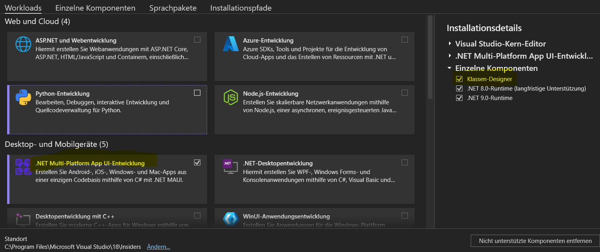
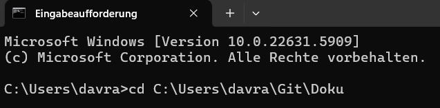
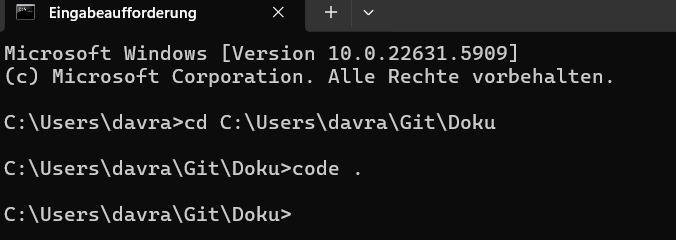
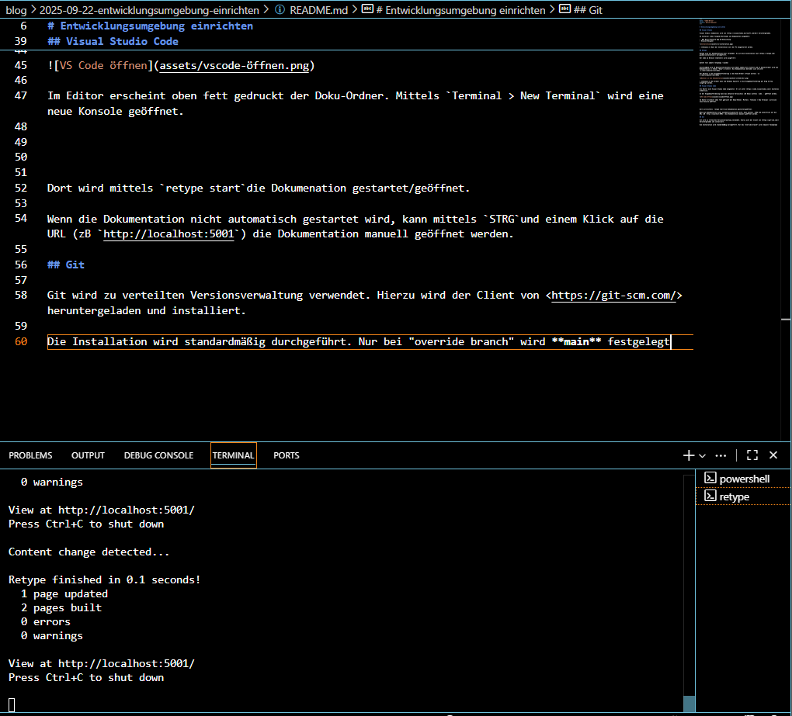

# Entwicklungsumgebung einrichten

## Visual Studio

Visual Studio (Community) wird von <https://visualstudio.microsoft.com/de/> heruntergeladen.

Im Installer wrden folgende Workloads und Komponenten ausgewählt:

- .NET Multi-Platform App UI-Entwicklung
- Klassen-Designer



> **Hinweis:** Nach der Installation soll der PC neugestartet werden.

## Retype

Retype wird als Dokumentations-Tool verwendet. Es wird die Installation laut <https://retype.com/guides/installation/> durchgeführt.

Der Code im Bereich **dotnet** wird ausgeführt:

```
dotnet tool install retypeapp --global
retype start
```

Anschließend wird im Benutzerverzeichnis ein Ordner namens Git erstellt und in diesem Ordner wird die Dokumentation (= Ordner "Doku") erstellt. Die Dokumentation befindet sich zB unter `C:\Users\mmuster\Git\Doku`.

Der Wechsel in der Eingabeaufforderung in den Doku-Ordner erfolgt mittels `cd C:\Users\mmuster\Git\Doku`.



> **Hinweis:** Der Ordner kann vom Windows Explorer in die Eingabeaufforderung per Drag & Drop eingefügt werden.

## Visual Studio Code

Als Editor wird Visual Studio Code eingesetzt. Er ist unter <https://code.visualstudio.com/> kostenlos erhältlich.

In der Eingabeaufforderung kann das aktuelle Verzeichnis (zB Doku) mittels `code .` geöffnet werden.



Im Editor erscheint oben fett gedruckt der Doku-Ordner. Mittels `Terminal > New Terminal` wird eine neue Konsole geöffnet.


Dort wird mittels `retype start`die Dokumenation gestartet/geöffnet.



Wenn die Dokumentation nicht automatisch gestartet wird, kann mittels `STRG`und einem Klick auf die URL (zB `http://localhost:5001`) die Dokumentation manuell geöffnet werden.

## Git

Git wird zu verteilten Versionsverwaltung verwendet. Hierzu wird der Client von <https://git-scm.com/> heruntergeladen und installiert.

Die Installation wird standardmäßig durchgeführt. Nur bei "override branch" wird **main** festgelegt