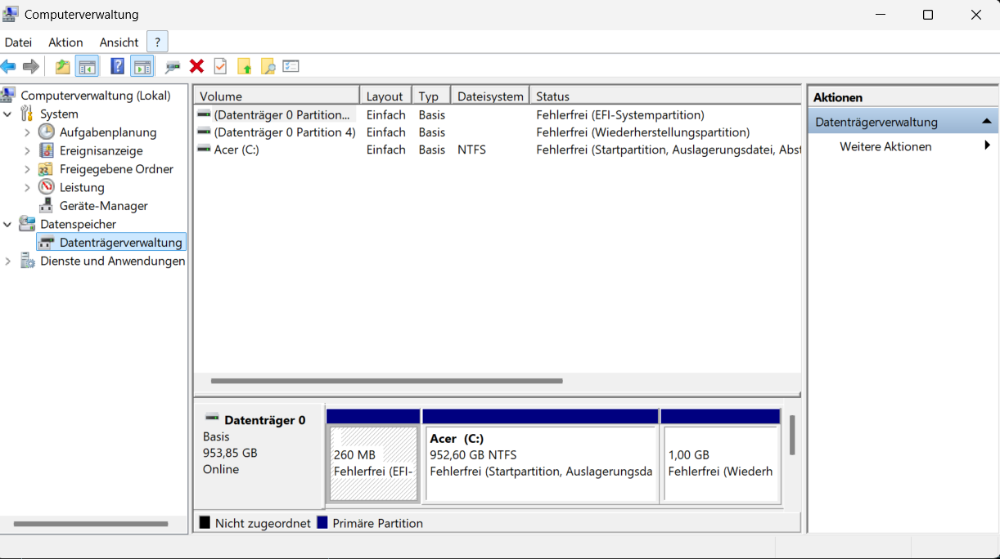
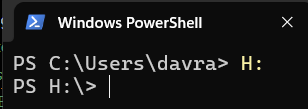
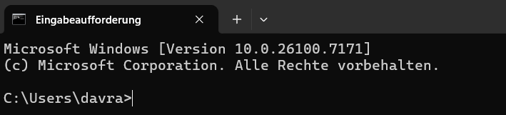

# Dateisystem

## Windows

Windows unterteilt Festplatten in Partitionen. Eine Festplatte kann eine oder mehrere Partitionen aufweisen.



Partitionen können einen Namen (Buchstaben) haben. Der Wechsel zwischen den Partitionen erfolt folgendermaßen:



Es wird also der Buchstabe mit einem Doppelpunkt angegeben. Es kann u allen Netzwerken, Datenpartitionen, Wechselmedien ( externe Festplatte) etc. gewechselt werden.

In Windows ist `\` (Backslash) das Rootverzeichnis in einer Partition. Wird zB `H:\` angegeben, so bedeutet dies, dass man sich in der Partition bzw. beim Laufwerk H: im Stammverzeichnis befindet.

Das Pfadtrennzeichen in Windows ist ebenfalls `\`. Ein Pfad zum eigenen Benutzerverzeichnis (=`Home` bzw. Ùserdir`) sieht folgendermaßen aus:

```
C:\Users\davra
```

Beim öffnen einer Konsole wird standardmäßig in diesen Ordner gewechselt:



### Relative und absolute Pfade

Bei einem relativen Pfad wird stets vom aktuellen Verzeichnis aus in ein anderes Verzeichnis gewechselt.

**Beispiel:** Nach dem Öffnen der CMD befindet man sich in `C:\Users\davra` und mit dem folgenden Befehl wird ausgehend vom `davra` -Verzeichnis in den Ordner `Git` gewechselt:

```
cd Git
```

Wird mit `cd \Users\davra\Git` in das Verzeichnis gewechselt, so bedeutet dies, dass ausgehend vom Rootverzeichnis in den Git-Ordner gewechselt wird - hierbei handelt es sich um eine absolute Pfadangabe.