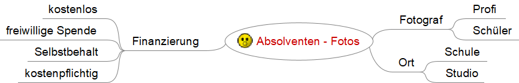
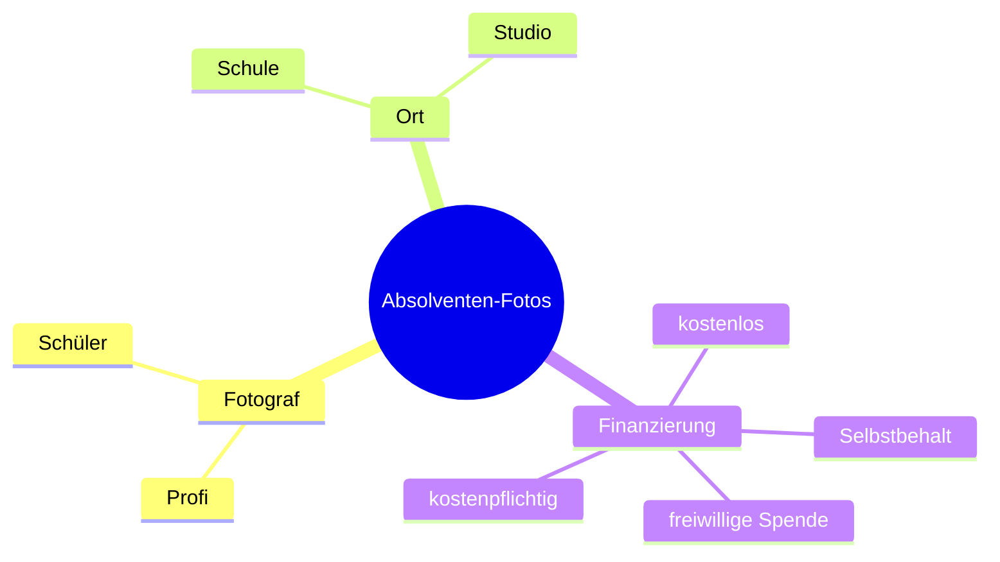

# Mindmap

Mindmaps dienen zur **visuellen Darstellung** eines Themas. Die einzelnen **Knoten** können auch dazugehörige **Unterknoten** aufweisen.
Mit *Kommentar* oder *Symbolen* können zusätzliuche Informationen aufgeueichnet werden.
Durch die Erstellung einer **Mindmap** wird das **Thema sehr  strukturiert** darstellbar.

[!file](assets/absolventenfoto.mm)





```markdown
mermaid
mindmap
    root((Absolventen-Fotos))
            Fotograf
                Profi
                Schüler
            Ort
                Schule
                Studio
            Finanzierung
                kostenlos
                freiwillige Spende
                Selbstbehalt
                kostenpflichtig
```